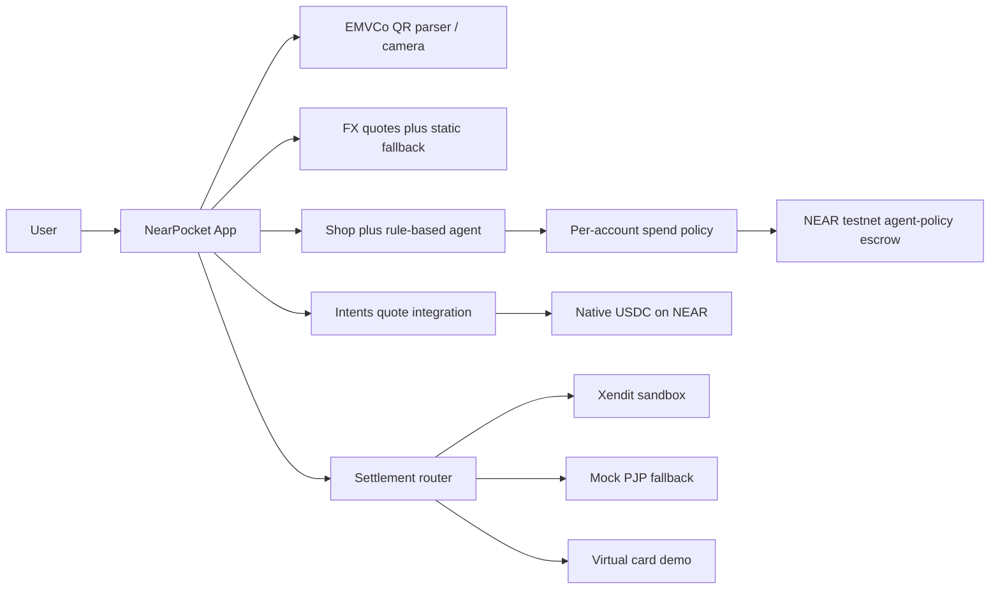

# NearPocket

People in Asia already pay by scanning a QR code, but a NEAR wallet still feels like a crypto app, and a shopping agent that can sign by itself can drain the balance. NearPocket is a NEAR testnet wallet that pays like a normal app: local QR in, USDC on NEAR underneath, and a rule-based shopping agent that cannot spend until the user approves on-chain.

**License:** MIT

## See it

Live demo (no env, no install): **https://nearpocket.vercel.app**

Open the link, choose **Try demo**, scan the PromptPay sample on Pay, then ask the shop agent to watch a deal. Nothing in the demo moves real money.

Screenshots: [landing](docs/screenshots/landing.png) · [home](docs/screenshots/home.png) · [pay](docs/screenshots/pay-confirm.png) · [shop](docs/screenshots/shop.png)

## Real vs demo

| Piece | Status |
| --- | --- |
| EMVCo parser + CRC + camera / upload | **Real** |
| FX (Frankfurter/ECB, cross-check open.er-api, static table if both are down) | **Real** when reachable; UI shows source. **Fallback rates** if not |
| Agent-policy contract | **Live on testnet.** [`pocket.nearpocket.testnet`](https://testnet.nearblocks.io/address/pocket.nearpocket.testnet) holds each wallet's USDC escrow and releases it only on that wallet's approval. Payouts go to [`settle.nearpocket.testnet`](https://testnet.nearblocks.io/address/settle.nearpocket.testnet) |
| Per-account escrow | **In the new contract.** Deposit with `ft_transfer_call`, `request_spend` locks it, `approve_spend` releases it. Not live until the new account is deployed |
| Gasless shop approval | **Testnet relayer** when `RELAYER_ACCOUNT_ID` and `RELAYER_PRIVATE_KEY` are set. Otherwise the connected wallet pays gas, or the step stays on this device |
| Intents quote integration | **Quotes are real** (1Click dry quote). **Execution is not run** |
| Marketplace search | Amazon via DummyJSON when reachable; other shops **mocked**, with real search URLs, labeled |
| Xendit QRIS | **Sandbox payment (Xendit test mode)** only when `XENDIT_SECRET_KEY` is set. If Xendit or 0xramp is unreachable (network or HTTP 5xx), settlement **falls back to the labeled mock**. A 4xx stays a failed receipt |
| NearPocket Card / top-up | **Demo** virtual card. Intents quotes are real; card settlement is demo |
| 0xramp off-ramp adapter | **Optional, off by default.** Staging adapter only, used when `ZEROXRAMP_*` is set. The live demo does not set it |
| Wallet login | Meteor / HOT / Intear / NEAR Mobile · in-browser seed · Privy Google · **Demo** |
| QRIS, PromptPay, DuitNow, card | Highlighted flows (parser real; fiat settlement is sandbox or demo) |
| PayNow, JPQR, Korea QR | EMVCo parse is real. Settlement is demo |
| More rails (demo): QR Ph, VietQR, UPI | **Demo** corridors |
| Saved delivery address | **Demo** profile on this device. Asked at checkout, then reused. Receipts mask the phone |
| Shop order receipt | **Demo payment** for marketplace checkout. No live off-ramp and no marketplace charge |

Crypto is not sent to merchants. That is a compliance choice (BI/OJK in Indonesia and the same idea elsewhere): production is user USDC on NEAR, then a licensed partner pays local fiat.

Payment labels in the app:

| What happened | Label |
| --- | --- |
| Mock settlement | Demo payment completed |
| Xendit test mode | Sandbox payment (Xendit test mode) |
| A NEAR testnet transaction from that action | Confirmed on NEAR testnet, with that transaction hash |

A mock receipt never says only "Paid". A receipt links a transaction hash only when that action sent it. Older hashes sit under **Example policy contract transactions**.

## Shop order flow

Shop checkout (`merchant_checkout`) writes a labeled demo receipt. It does not send crypto to the marketplace, does not broadcast a NEAR Intents swap, and does not call a payout partner.

1. Search and the rule-based plan do not ask for a delivery address.
2. Checkout asks for the address, then shows USDC as locked pending approval. With the per-account contract and an escrow balance, that step is `request_spend` then `approve_spend`. `approve_spend` is what transfers USDC to the settlement account. Without escrow, or on the previous contract, the app says so and does not pretend funds moved.
3. You approve the purchase.
4. USDC is shown as sent to a licensed off-ramp partner (demo) and converted into the display currency (demo).
5. Marketplace checkout is shown as a demo payment. The marketplace's own buyer protection holds those funds until delivery.
6. The receipt shows a demo order id and the ship-to address.

Intents quote integration only prices a token swap. Execution is not run. The fiat leg is still a demo, or a partner sandbox when a sandbox key is set.

## Per-account policy contract

Every connected wallet is `predecessor_account_id`. On first use the contract stores:

- 75 USDC daily limit
- 30 USDC per item
- approval required

That account's queue, plans, requests, and escrow are separate. `set_policy`, `queue_item`, `request_spend`, and `approve_spend` all run as that wallet. The contract admin is only for `set_settlement_account` and `set_global_paused`.

`request_spend` locks USDC from that account's escrow and checks the daily and per-item limits on the locked amount. `approve_spend` by the same account calls `ft_transfer` to the settlement account. The callback restores the lock if the transfer fails. `reject_spend` and `expire_spend` return the lock to escrow. `withdraw` sends unlocked escrow back to the account.

Views: `get_policy`, `get_escrow`, `get_request`, `get_item`, and `get_plan` take `account_id`. `get_config` and `contract_version` (returns `2`) do not.

The account id is `NEXT_PUBLIC_AGENT_POLICY_CONTRACT`, then `src/config/deployed.json`, then `pocket.nearpocket.testnet`. There is no state migration. The previous contract did not hold USDC. Deploy the new wasm to a new account.

### Deploy and init

Replace `pocket.nearpocket.testnet` with the funded testnet account you create. Rust 1.85 or newer.

```bash
cd contracts/agent-policy
cargo +stable build --target wasm32-unknown-unknown --release
cp target/wasm32-unknown-unknown/release/nearly_agent_policy.wasm res/nearly_agent_policy.wasm

near deploy pocket.nearpocket.testnet res/nearly_agent_policy.wasm --networkId testnet
near call pocket.nearpocket.testnet new \
  '{"usdc_contract":"usdc.fakes.testnet","settlement_account":"settle.nearpocket.testnet"}' \
  --accountId pocket.nearpocket.testnet --networkId testnet
near call usdc.fakes.testnet storage_deposit \
  '{"account_id":"pocket.nearpocket.testnet"}' \
  --accountId pocket.nearpocket.testnet --deposit 0.0125 --networkId testnet
near call usdc.fakes.testnet storage_deposit \
  '{"account_id":"settle.nearpocket.testnet"}' \
  --accountId pocket.nearpocket.testnet --deposit 0.0125 --networkId testnet
```

Init args for `new`:

| Arg | Value |
| --- | --- |
| `usdc_contract` | `usdc.fakes.testnet` |
| `settlement_account` | `settle.nearpocket.testnet` (any payout account other than the contract itself) |

No `migrate` call. The earlier single-policy contract `nearly-7b1462.testnet` is retired; do not run `new` on it.

On Vercel set:

```bash
NEXT_PUBLIC_AGENT_POLICY_CONTRACT=pocket.nearpocket.testnet
```

If the relayer is enabled, set `NEAR_CONTRACT_ID` to the same account. A user funds escrow with the token (1 yoctoNEAR on `ft_transfer_call`):

```bash
near call usdc.fakes.testnet ft_transfer_call \
  '{"receiver_id":"pocket.nearpocket.testnet","amount":"1000000","msg":""}' \
  --accountId <wallet.testnet> --depositYocto 1 --gas 100000000000000 --networkId testnet
```

`1000000` is 1 USDC. Until that deposit exists, the app still lets the wallet set a policy and queue a plan, and it says the spend cannot lock funds yet.

Details and the method table: `contracts/agent-policy/README.md`.

## Example policy contract transactions

Examples on `pocket.nearpocket.testnet`, signed by the wallet `nearpocket.testnet` (not the contract admin). They are examples, not receipts for a later action.

| Action | Explorer |
| --- | --- |
| Create, deploy, and `new` | https://testnet.nearblocks.io/txns/EZPQbsQ2PfPwidyk2xz27V9pMYycJwiVpcqNME8HJ9Lq |
| Deposit 5 USDC (`ft_transfer_call`) | https://testnet.nearblocks.io/txns/FfxucrDo82f2m433wrTfzMgNphiB9PLifA9Tsd7T4cfy |
| `queue_item` | https://testnet.nearblocks.io/txns/6WX2BGsxxpWs3UTMgTYy5BPeVTJdPE6Fn8xqHnwYVAe3 |
| `request_spend` 2 USDC (locks escrow) | https://testnet.nearblocks.io/txns/5PeRoyfokdiNmVYk14WM9SASjiUhpjoa3wV9QWeJZTVK |
| `approve_spend` 2 USDC (`ft_transfer` to settlement) | https://testnet.nearblocks.io/txns/H8irDtp9X1WXBS9Ls27xE8k6JFQDj6LbGTJ6r8D2P2Jt |
| `request_spend` 1 USDC | https://testnet.nearblocks.io/txns/BTYA6mczSnfgPRmjgT56nDseZH9jXEGeUrACafb5Zejq |
| `reject_spend` (lock returns to escrow) | https://testnet.nearblocks.io/txns/6S468TNPgyrB6U9FtJK7Pz658WzyJh4Baxpyzm8mv9UB |
| `withdraw` 1 USDC | https://testnet.nearblocks.io/txns/6pbwGy7srVGWR9Dt2H6o9wMzbf9rK6ujjV3im1ej1eNc |

After these calls the wallet's escrow showed 2 USDC available and 0 locked, and `settle.nearpocket.testnet` held the 2 USDC released by `approve_spend`.

## The shopping agent

The shop agent is rule-based price watching. `src/lib/agent/rules.ts` parses a budget out of the user's text, watches a price, and moves an item to `awaiting_approval` when the price hits the target. It never signs `approve_spend`.

If `NEAR_AI_API_KEY` or `OPENAI_API_KEY` is set on the server, `src/app/api/agent/route.ts` may replace the one-sentence reason. That sentence cannot change the decision and cannot spend. With no key, the rule-based reason is what the user sees.

What stops a drain is the contract plus the key, not the wording.

## Roadmap

The app stays on **NEAR testnet** so anyone can try it with no real funds and no custody of user money.

Production, later:

1. Keep USDC on NEAR as the user's balance. Still do not pay merchants in crypto.
2. Settle through a **licensed** payment partner (Xendit-class PJP for QRIS and the live cross-border corridors; a card issuer for the worldwide card). PH / VN / IN stay demo until a licensed partner covers them.
3. Indonesia: follow **BI/OJK** — crypto is not a payment instrument, so the partner converts to IDR and pays QRIS. Same pattern for other local regulators.
4. Business model: the quote already adds a **35 bps** fee (`FEE_BPS` in `src/lib/fx/quote.ts`), plus a revenue share with the licensed partner. Not switched on. No mainnet deployment in this repo.

## Threat model (agent-policy)

The new contract holds USDC per account. Approval is the call that releases it.

- `set_policy`, `queue_item`, `request_spend`, `approve_spend`, `reject_spend`, `expire_spend`, and `withdraw` use the predecessor account. One wallet cannot approve or withdraw another wallet's escrow.
- `set_settlement_account` and `set_global_paused` require the contract admin. A stranger's call panics with `admin only`.
- A gasless meta-transaction does not change the predecessor. The predecessor is the account that signed the delegate, not the relayer.
- The agent key should be a **function-call access key** whose method list is `request_spend` (views need no key). That key cannot approve, raise limits, withdraw, or change the settlement account.
- With `require_approval` (the default), `request_spend` locks escrow and returns `awaiting_approval`. `approve_spend` performs the `ft_transfer`. The daily counter increases when the amount is locked, and a reject, expire, or failed transfer gives it back on the same UTC day.
- `request_spend` and `approve_spend` reject `over per-item max`, `over daily limit`, and `insufficient escrow`. A global or per-account pause rejects both.
- The daily counter resets when `block_timestamp` crosses UTC midnight. The reset is applied on the next call.
- Turning `require_approval` off lets `request_spend` start the transfer immediately, still inside the limits. Leave it on.
- Testnet only.

## FAQ

**Why not send crypto directly to the merchant?**
In Indonesia, crypto is not a payment instrument under BI/OJK. NearPocket never transfers tokens to a merchant account. The intended production path is USDC on NEAR, then a licensed partner pays the merchant in local fiat. The mock receipt says "Demo payment completed". The Xendit adapter says "Sandbox payment (Xendit test mode)". Xendit Test Mode creates a QR object. It does not send crypto.

**Who stops the agent draining the funds?**
The agent-policy contract and the key. The agent can `request_spend` only up to the per-item and daily limits, and only against USDC that account has deposited. With approval required, that call locks escrow and does not transfer it. `approve_spend` and `withdraw` are the account's own calls, so a function-call key that omits them cannot release the escrow. The rule engine cannot sign either.

**What is real and what is mock?**
The table at the top. Short version: EMVCo parse, FX (with a static fallback), Intents **quotes**, and the per-account contract interface are real. Intents execution, the card, marketplace connect, PH/VN/IN rails, and fiat payout without a sandbox key are demo or mock and labeled as such. The previous testnet contract does not escrow USDC.

**What if the FX API or Xendit is down?**
FX tries Frankfurter, then open.er-api, then the static `FALLBACK_USD` table in `src/lib/fx/quote.ts` (`source: "fallback"`). The pay screen still gets a number. If Xendit or 0xramp throws a network error or returns HTTP 5xx, `settle()` catches `PartnerDownError` and completes through the mock adapter, labeled as a demo payment. A bad key (HTTP 4xx) stays a failed receipt so a misconfigured secret is visible.

## Intents quote integration

Dry quotes are what the app calls today: `GET /api/quote?from=NEAR&amount=1` posts to 1Click with `dry: true` and `depositType: INTENTS`. If 1Click is unreachable, the response is a labeled local estimate (`real: false`).

The live path is in `src/lib/near/intents.ts`: `dry: false` → deposit address → `ft_transfer` plan (1 yoctoNEAR attached) → `GET /v0/status`. `POST /api/quote` with `{ "execute": true }` builds that plan only when `NEAR_INTENTS_EXECUTE=1`, and it still does **not** broadcast. `broadcastIntentDeposit` returns before any RPC unless `NEAR_INTENTS_EXECUTE`, `NEAR_INTENTS_BROADCAST`, and `NEAR_INTENTS_MAINNET_ACK` are all `1`. None of those are set in `.env.example` or in CI.

This was **verified with dry quotes and a mocked HTTP unit test** (`npm run test:intents`). It was **not** executed against live 1Click. A non-dry quote opens a mainnet deposit address, and broadcasting the deposit spends real funds. This build is testnet-only. Card settlement and marketplace settlement stay demo.

## How to run

No env vars required:

```bash
npm install
npm run dev
```

Open http://localhost:3000. `npm test` and `npm run build` also pass with an empty environment. Google login stays off until `NEXT_PUBLIC_PRIVY_APP_ID` is set. `XENDIT_SECRET_KEY` is server-only; it is not a `NEXT_PUBLIC_` variable.

```bash
npm test                 # EMVCo/QRIS, i18n, Intents gate, shop order, relayer allowlist
npm run test:contract    # agent-policy unit tests (Rust 1.85+)
npm run lint
npm run build
```

Contract tests use the near-sdk mock VM, not a sandbox node, and they run in GitHub Actions (`.github/workflows/ci.yml`). Details: `contracts/agent-policy/README.md`.

### Testnet demo script

```bash
NEAR_ACCOUNT_ID=<wallet.testnet> NEAR_PRIVATE_KEY='ed25519:...' npm run testnet:demo
# or
NEAR_CREDENTIALS_FILE=./.nearly-credentials/owner.json npm run testnet:demo
```

The JSON file is `{ "account_id", "private_key" }`. Default contract is `pocket.nearpocket.testnet`. Override with `NEAR_CONTRACT_ID`. The signer does not need to be the contract admin. Testnet only.

### Gasless transactions

Shop request, approval, and buy now can be sent as a NEAR meta-transaction (NEP-366) on testnet. The user signs a delegate action. The relayer account wraps that signature in a transaction, pays the gas, and the contract still sees the signing account as the predecessor. The receipt shows "Gas covered by NearPocket" and a testnet explorer link when the relay is included. If the relayer is not configured, or the relay fails before it is included, the same call is sent by the connected wallet and the user pays gas. Demo mode never leaves this device. QR pay does not call the policy contract.

Signing:

- A wallet that implements `signDelegateActions` (or `signDelegateAction`) signs the delegate with a key it already holds.
- Meteor, HOT, Intear, and NEAR Mobile in the current wallet-selector packages do not sign delegates. For those wallets, and for an in-browser testnet account, NearPocket generates a function-call key in the browser, stores it on this device, and registers it once on the account (that registration is a normal transaction). Later calls are signed with that key and relayed. The key is limited to the agent-policy contract and its user-facing methods. It cannot change the settlement account or the global pause.

The relayer only forwards:

- Function calls. NEAR transfer, AddKey, DeleteKey, DeployContract, DeleteAccount, and Stake are rejected.
- Receiver is the agent-policy contract (`NEAR_CONTRACT_ID`, or `NEXT_PUBLIC_AGENT_POLICY_CONTRACT`, default `pocket.nearpocket.testnet`) or the testnet USDC contract (`NEAR_USDC_CONTRACT_ID`, default `usdc.fakes.testnet`).
- User methods on the policy contract, including `request_spend`, `approve_spend`, `queue_item`, `set_policy`, `reject_spend`, and `withdraw`. Admin methods `set_settlement_account` and `set_global_paused` are forwarded only when the signer is the contract admin from `get_config`.
- On the token: `ft_transfer`, `ft_transfer_call`, `storage_deposit`.
- At most 100 TGas per action, at most 8 actions, and at most 1 yoctoNEAR attached in total. Only `ft_transfer` and `ft_transfer_call` may attach that 1 yoctoNEAR. `storage_deposit` is allowlisted but cannot pull storage fees from the relayer or the user through this route.
- An ed25519 public key, a non-zero nonce, a signature that matches, and a `max_block_height` that has not expired and is not more than 1,000 blocks ahead.

Buy now sends `queue_item`, then `request_spend`, then `approve_spend`, so the lock and the release are one user action and the daily counter is applied once.

Abuse limits for this prototype live in memory on each server instance: 12 requests per IP per minute, and 40 relayed transactions per sender account per UTC day. A new instance starts from zero, and instances do not share counters.

```bash
NEAR_CREDENTIALS_FILE=./sender.json \
RELAYER_ACCOUNT_ID=nearpocket.testnet \
RELAYER_PRIVATE_KEY='ed25519:...' \
npm run relay:demo
```

`NEAR_PRIVATE_KEY` is ignored. The sender key comes only from `NEAR_CREDENTIALS_FILE`. The relayer can also be `RELAYER_CREDENTIALS_FILE`. The script calls `get_policy` for the sender (it does not change contract state) and prints the testnet transaction hash. It refuses mainnet.

### Optional env

See `.env.example`. `NEXT_PUBLIC_PRIVY_APP_ID` is a publishable id. Secrets (`XENDIT_SECRET_KEY`, `RELAYER_PRIVATE_KEY`, `NEAR_PRIVATE_KEY`, model keys, 0xramp) stay server-side or in the shell for the demo scripts.

### Quick walkthrough (~2 min)

1. `/` → **Sign in** → **Try demo**.
2. `/home` → USDC plus a local estimate. Settings → Thailand or Worldwide USD.
3. `/pay` → **PromptPay** sample → confirm → **Pay**. The receipt says "Demo payment completed".
4. `/shop` → search “earbuds” → **Ask agent** or **Buy now**. The address is asked at checkout. The agent waits.
5. `/activity` for the timeline. Example contract hashes are under their own heading.
6. `/api/contract` · `/api/quote?from=NEAR&amount=1` · `/api/fx?table=1`.

## Product map

| Route | What you do |
| --- | --- |
| `/` | Landing. QRIS, PromptPay, DuitNow, and the card are highlighted. PH / VN and the other demo rails sit under “More rails (demo)” |
| `/login` | Create wallet · Connect NEAR · Google/Privy · Try demo |
| `/home` | USDC balance · Scan & Pay · Top up · Shop · agent approvals |
| `/pay` | Camera / upload / paste / sample QR → confirm → settle |
| `/shop` | Marketplaces · search and plans · checkout address · Buy now / Ask agent · order receipt · limits |
| `/activity` | Payments, purchases, card, top-ups, agent actions |
| `/settings` | Language · home country / display currency · delivery address · FX table · Sign out |

`/belanja` → `/shop`, `/aktivitas` → `/activity`, `/app` → `/home`.

## Architecture



## License

MIT
