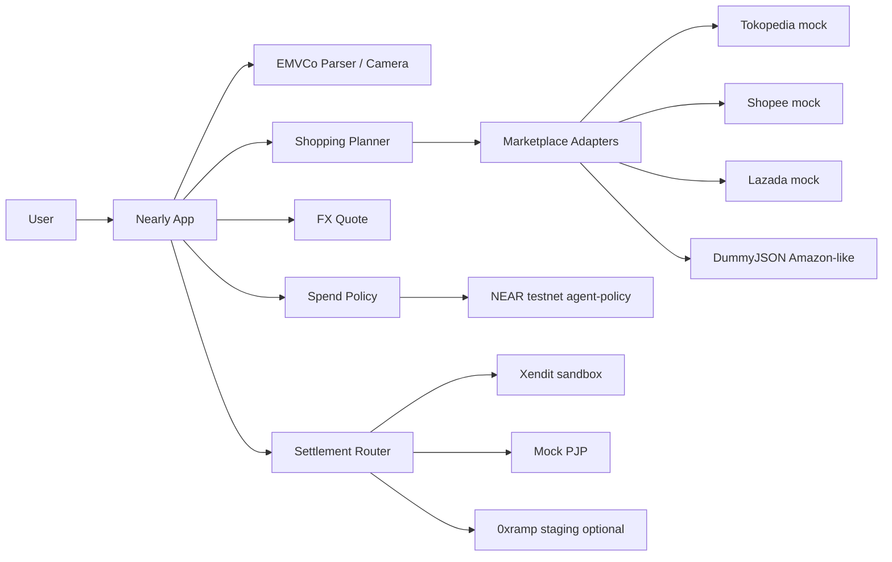

# Nearly — Pay nearly anywhere

> **Name note:** product display name lives in [`src/config/brand.ts`](src/config/brand.ts). Repo / Vercel project stay `nearly` until Abi picks a final name (current name may already be taken).

**NEAR HACKATHON** · tracks: `realworld` (+ `agents`)

A NEAR wallet that feels like a normal payment app: scan QRIS (and ASEAN QR corridors), pay worldwide via card/link rails, shop or sell as a merchant, and run **shopping plans** where an agent searches multiple marketplaces — **you approve every purchase**.

**Live demo:** https://nearly-ijustabi.vercel.app  
**Alias:** https://nearly-blue.vercel.app  
**Repo:** https://github.com/mozoraID/nearly

---

## Problem

People hold stablecoins on NEAR but still pay warungs and online stores with local rails (QRIS, PromptPay, cards…). They also want an agent that can **plan** a shopping list across Tokopedia / Shopee / Lazada / Amazon — without giving the agent unlimited keys.

## Solution

| Mode | What you do |
| --- | --- |
| **Pay QR / Scan** | Paste or camera-scan EMVCo QR → detect rail → FX quote → settle via PJP adapter |
| **Worldwide** | Any token (Intents dry-run) → USDC → mock virtual card / payment link |
| **Shop** | Buyer catalog + merchant QR generator |
| **Shopping plans** | Budget + deadline + item list → agent searches marketplaces → waitlist → approve/reject |
| **Top up (beta)** | Demo USDC credit via QRIS/card/NEAR (mocked) |

## Architecture



### How NEAR is used

- **USDC-denominated** balances & quotes.
- **NEAR Intents dry-run** for any-token → USDC (no Intents testnet — Q-007).
- **On-chain agent-policy** at [`nearly-7b1462.testnet`](https://testnet.nearblocks.io/address/nearly-7b1462.testnet): daily limit, per-item max, approval gate, shopping plan upsert.
- **MyNearWallet / wallet-selector** testnet login (or Demo account for zero-setup).

### Sample on-chain txs (testnet)

| Action | Explorer |
| --- | --- |
| Deploy | https://testnet.nearblocks.io/txns/9uz6FqFYDertGpXWQ151ERaxsRzdPQhZkGLZiCAqy3sh |
| set_policy | https://testnet.nearblocks.io/txns/FB7CwPsFg77txpbvdGhC8AqwbeFH3JCmtuuVHUw9Hrf2 |
| queue_item | https://testnet.nearblocks.io/txns/AYg9utitCS6eMatv4QhHqyCGoVYp6QBy5VXnrWAMAPEU |
| request_spend | https://testnet.nearblocks.io/txns/3eFcr6dxLcnLkcYBKJXbAssTQA5ZCnkirQn4GD31q1cw |
| approve_spend | https://testnet.nearblocks.io/txns/Em45x6JBvu58xeVWxQm66hx2r6S4JYYxWbjeYtWoNpvD |
| upsert_plan | https://testnet.nearblocks.io/txns/7nYrj1ECqyxWQXRJTL6a7iXcfdVq6mT81FbFYYN7wuSg |

## Compliance

**Crypto is not a payment instrument in Indonesia (BI / OJK).**  
Nearly never sends crypto to merchants. Production: user USDC → licensed PJP → IDR/local fiat QRIS/card credit.

## What’s real vs mocked

| Piece | Status |
| --- | --- |
| EMVCo parser + CRC + camera scan | **Real** |
| FX (Frankfurter) | **Real** when reachable |
| Agent-policy contract on testnet | **Real** (see txs above) |
| On-chain policy view in UI | **Real** via RPC |
| Marketplace search | **Amazon-like** via DummyJSON when reachable; Tokopedia/Shopee/Lazada/eBay **mocked adapters** (labeled) |
| Xendit QRIS | **Real Test Mode** when `XENDIT_SECRET_KEY` set; else mock |
| 0xramp | Staging adapter ready; **needs partner credentials** (ZEC-centric SDK — no public USDC sandbox) |
| Intents execution / card / top-up | **Dry-run / mocked** |
| Wallet login | MyNearWallet testnet **real redirect**; Demo account for zero secrets |

## How to run (zero secrets)

```bash
npm install
npm run dev
```

Open http://localhost:3000.

### Optional env (see `.env.example`)

| Var | Purpose |
| --- | --- |
| `NEXT_PUBLIC_NEAR_NETWORK` | `testnet` (default) |
| `NEXT_PUBLIC_AGENT_POLICY_CONTRACT` | default `nearly-7b1462.testnet` |
| `XENDIT_SECRET_KEY` | Xendit **test** secret (`xnd_development_…`) |
| `ZEROXRAMP_PARTNER_ID` | 0xramp issued partner id |
| `ZEROXRAMP_API_BASE_URL` | staging https origin |
| `ZEROXRAMP_API_KEY` | optional bearer |
| `NEAR_AI_API_KEY` / `OPENAI_API_KEY` | optional agent copy |

### Get a NEAR testnet account

1. Open https://testnet.mynearwallet.com and create an account (free), **or**
2. Use faucet helper: create a keypair and `POST https://helper.testnet.near.org/account` with `{ newAccountId, newAccountPublicKey }`, **or**
3. Use `near-cli-rs`: `near account create-account sponsor-by-faucet-service <name>.testnet …`

Then connect in the app via **MyNearWallet**.

### Deploy the policy contract yourself

```bash
# needs Rust + wasm32 target
cd contracts/agent-policy
cargo build --target wasm32-unknown-unknown --release
# deploy wasm with near-api-js / near-cli to your testnet account, then call new(...)
```

Set `NEXT_PUBLIC_AGENT_POLICY_CONTRACT` to your account.

### Demo script (AI screener)

1. `/` → wallet + MyNearWallet / Demo.
2. `/pay` → Indonesia sample → quote → Sign & pay → receipt.
3. `/scan` → camera QR (mobile) or fall back to paste.
4. `/plans` → create plan → Search marketplaces → Approve buy.
5. `/api/contract` → see live on-chain policy + explorer links.
6. `/topup` → demo credit balance.
7. `/shop` → merchant QR.

```bash
npm run test:qris
npm run build
```

## 0xramp note

Per [docs.0xramp.app](https://docs.0xramp.app): partner SDK embeds a pane for **ZEC ↔ local fiat**; environments are `production` / `staging` with issued `partnerId`. Local sandbox pane is host simulation only. There is **no** public keyless USDC→IDR REST sandbox like Xendit Test Mode. Adapter is implemented for when Abi receives partner credentials (`ZEROXRAMP_*`).

## License

MIT · Built at **NEAR HACKATHON**.
