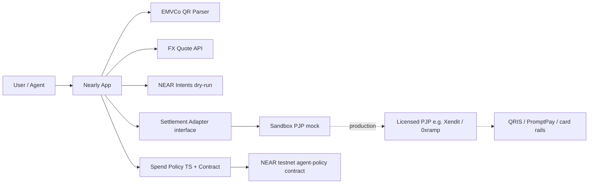

# Nearly — Pay nearly anywhere

**NEAR HACKATHON** · tracks: `realworld` (+ optionally `agents`)

> A NEAR wallet that feels like a normal payment app: scan QRIS (and ASEAN QR corridors), pay worldwide via card/link rails, shop or sell as a merchant, and queue purchases with an autonomous agent that **cannot spend without your approval**.

**Live demo:** see Vercel deployment linked in the repo About / releases after deploy.  
**X demo post:** (Abi posts this — draft in `/docs/DEMO.md`)

---

## Problem

People hold stablecoins on NEAR (or any chain via Intents) but still pay warungs, hawker stalls, and online stores with local rails — **QRIS in Indonesia**, PromptPay, DuitNow, NETS, JPQR, Korea QR, or cards elsewhere. Existing NEAR real-world money tools cover remittance / Cross-Pay / off-ramps, but there is no polished **wallet + merchant + agent waitlist** product that:

1. Parses real EMVCo QR payloads per country,
2. Quotes USDC → local fiat,
3. Settles through a **licensed PJP-shaped** off-ramp (not crypto-to-merchant),
4. Lets an AI agent wait for a price **while the user keeps spend limits**.

## Solution

**Nearly** is a mobile-first Next.js app:

| Mode | What you do |
| --- | --- |
| **Pay QR** | Paste/scan EMVCo QR → detect rail → FX quote → sign → mock PJP pays merchant via QRIS/corridor |
| **Worldwide** | Any token (Intents dry-run) → USDC → mock virtual card / payment link |
| **Shop** | Buyer catalog checkout + **merchant mode** that generates a QRIS-shaped QR |
| **Agent** | Natural-language waitlist; price ticks; **approve/reject**; daily & per-item policy |

## Architecture



### How NEAR is used

- **Stablecoin rail:** balances and quotes denominated in **USDC on NEAR**.
- **NEAR Intents (dry-run):** any-token → USDC quotes (`src/lib/near/intents.ts`). Intents has **no testnet** (hackathon Q-007); production uses 1Click on mainnet.
- **Agent policy contract:** `contracts/agent-policy` — daily limit, per-item max, approval gate (function-call / allowance style). UI mirrors it so the demo runs without deploy.
- **Meta-tx ready:** settlement adapter is gasless-friendly; production would relay via a meta-transaction relayer limited to Nearly contracts.

## Compliance note (Indonesia & QRIS)

**Crypto is not a payment instrument in Indonesia (BI / OJK).**  
Nearly does **not** send crypto to merchants.

Production flow:

1. User signs an Intent / spend approval for USDC (or any token → USDC).
2. A **licensed payment service provider (PJP)** receives stablecoin / fiat equivalent.
3. The PJP pays the merchant in **IDR via QRIS** (or THB/MYR/SGD/JPY/KRW on linked corridors).

This repo’s settlement path is a **sandbox mock** behind a clean `SettlementAdapter` interface (`src/lib/settlement`). README and UI banners label every mock.

Cross-border QR partners (as commonly documented by BI corridors): Thailand PromptPay, Malaysia DuitNow, Singapore NETS, Japan JPQR, South Korea. China corridor status should be verified against [BI QRIS Antarnegara](https://www.bi.go.id/) before claiming live.

## What’s real vs mocked

| Piece | Status |
| --- | --- |
| EMVCo TLV parser + CRC-16 | **Real** (`src/lib/qris/parser.ts`) |
| Per-country sample QRs | **Real-shaped** (CRC valid), demo merchants |
| FX rates | **Real** via Frankfurter/ECB when reachable; else baked fallback |
| Settlement / card / QRIS payout | **Mocked** sandbox PJP adapter |
| NEAR Intents execution | **Dry-run** quotes only |
| Agent waitlist + policy checks | **Real logic** in TS; on-chain contract **code included**, deploy optional |
| LLM agent copy | Optional — works rule-based with **zero API keys** |

## How to run

Zero required secrets.

```bash
npm install
npm run dev
```

Open [http://localhost:3000](http://localhost:3000).

### Optional env

```bash
# .env.local
NEXT_PUBLIC_NEAR_NETWORK=testnet
NEXT_PUBLIC_AGENT_POLICY_CONTRACT=   # set after deploying contracts/agent-policy
NEAR_AI_API_KEY=                     # or OPENAI_API_KEY — enriches agent reasons
NEAR_AI_BASE_URL=                    # optional
```

### Demo script (judges / AI screener)

Do X → see Y:

1. Open `/` → see demo wallet balance + spend policy card.
2. Open `/pay` → click sample **indonesia** → **Get USDC quote** → see IDR→USDC rate → **Sign & pay** → receipt timeline with status `mocked` and compliance note.
3. Click samples **thailand / malaysia / singapore / japan / korea** → parser shows the matching rail name.
4. Open `/pay?tab=world` → pay a mock card amount from NEAR/USDT → receipt.
5. Open `/shop` → **Buy** a catalog item → receipt; switch **Merchant** → see QR code for your store.
6. Open `/agent` → paste a wish → **Add to waitlist** → **Price tick** until `awaiting approval` → **Approve buy** (respects daily/per-item limits) or **Reject**.
7. Toggle policy **Pause agent** → approve fails.

```bash
npm run test:qris   # CRC + country detection smoke test
npm run build       # production build
```

## Project layout

```
src/app/           # App Router pages: /, /pay, /shop, /agent + API routes
src/lib/qris/      # EMVCo parser, samples, rails
src/lib/fx/        # quotes
src/lib/settlement/# adapter interface + mock PJP
src/lib/agent/     # policy + rule-based agent
src/lib/near/      # network config + Intents dry-run
contracts/         # Rust agent-policy contract
docs/DEMO.md       # 60–90s video storyboard + X post draft
```

## Roadmap

- [ ] Deploy `agent-policy` to NEAR testnet + wire wallet-selector
- [ ] Meta-transaction relayer for gasless user/agent calls
- [ ] Mainnet Intents 1Click (tiny amounts / dry quotes)
- [ ] Sandbox keys for Xendit / Midtrans / 0xramp behind same adapter
- [ ] Camera QR scan (html5-qrcode already a dependency)
- [ ] Merchant dashboard with CSV export for accountants

## Judging notes

- **Technical:** real EMVCo parser, adapter pattern, optional on-chain policy, Intents-shaped quotes.
- **Design:** mobile-first wallet UX, clear mocked vs real labeling.
- **Impact:** everyday ASEAN merchant payments + worldwide fallback.
- **Originality:** wallet + merchant QR + agent waitlist with hard spend caps in one product.
- **Sustainability:** MIT, no mandatory paid APIs, clear path to licensed PJPs.

## License

MIT © mozoraID / Abi — built at **NEAR HACKATHON**.
