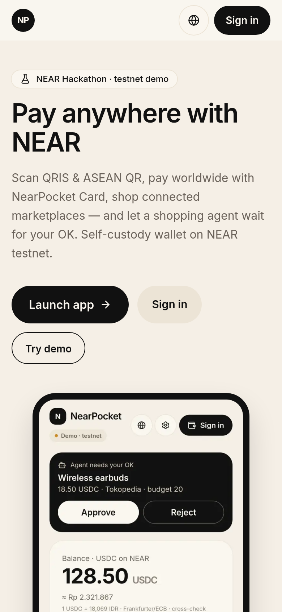
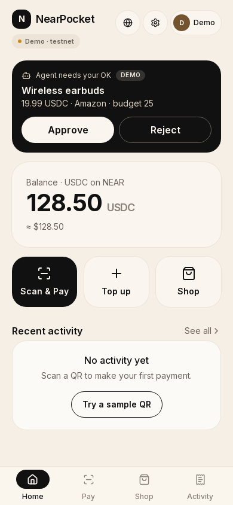
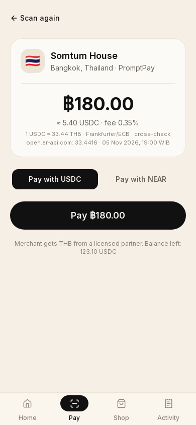
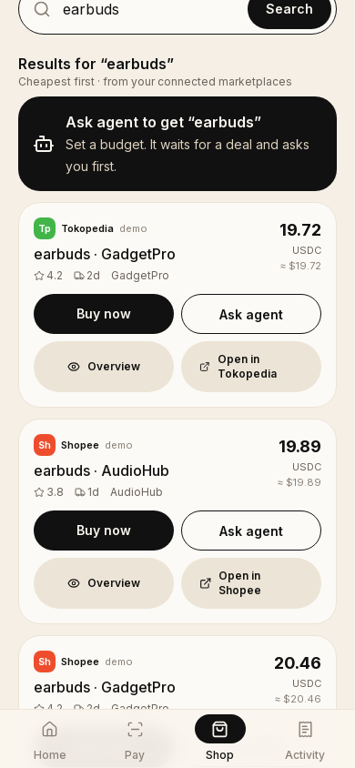
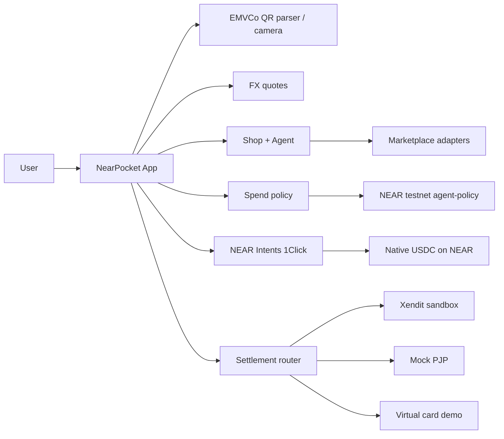

# NearPocket

**Your NEAR pocket for real-world money**

[](https://nearpocket.vercel.app)
[](https://nearhackathon.com)
[](LICENSE)

**Live:** https://nearpocket.vercel.app  
**Repo:** https://github.com/mozoraID/nearpocket  
**Tracks:** Real-World Money · Agent Economy

NearPocket is a **NEAR-native** mobile wallet that feels like a normal payments app:

- **Pay local QR** in Indonesia (QRIS), Thailand (PromptPay), Malaysia (DuitNow), Singapore (PayNow / SGQR), Philippines (QR Ph), Vietnam (VietQR), Japan (JPQR), South Korea (Korea QR), India (UPI · demo)
- **Pay worldwide** with NearPocket Card in **USD** (and EUR/GBP display) via **NEAR Intents / 1Click** → native USDC on NEAR
- **Shop** connected marketplaces; a **shopping agent** waitlists deals and **never spends without your on-chain approval**

Cream + black UI · EN default · Bahasa Indonesia and other locales via i18n · testnet only.

---

## Screenshots

| Landing | Home | Pay confirm | Shop |
| --- | --- | --- | --- |
|  |  |  |  |

---

## Architecture



### How NEAR is used

| Capability | Detail |
| --- | --- |
| **Native USDC on NEAR** | Ledger denomination for balances & settlement |
| **NEAR Intents / 1Click** | Any-token → USDC dry quotes via public 1Click API (execution labeled until mainnet / partner JWT) |
| **On-chain agent-policy** | [`nearly-7b1462.testnet`](https://testnet.nearblocks.io/address/nearly-7b1462.testnet) — daily limit, per-item max, approval gate, plan upsert *(account id kept from pre-rebrand deploy)* |
| **Function-call access keys** | Agent can queue / request; **cannot spend without user approve** |
| **Wallets** | Meteor / HOT / Intear / NEAR Mobile via wallet-selector · create-in-browser encrypted seed · Google via Privy · Demo mode for judges |

### Sample on-chain txs (testnet)

| Action | Explorer |
| --- | --- |
| Deploy | https://testnet.nearblocks.io/txns/9uz6FqFYDertGpXWQ151ERaxsRzdPQhZkGLZiCAqy3sh |
| set_policy | https://testnet.nearblocks.io/txns/FB7CwPsFg77txpbvdGhC8AqwbeFH3JCmtuuVHUw9Hrf2 |
| queue_item | https://testnet.nearblocks.io/txns/AYg9utitCS6eMatv4QhHqyCGoVYp6QBy5VXnrWAMAPEU |
| request_spend | https://testnet.nearblocks.io/txns/3eFcr6dxLcnLkcYBKJXbAssTQA5ZCnkirQn4GD31q1cw |
| approve_spend | https://testnet.nearblocks.io/txns/Em45x6JBvu58xeVWxQm66hx2r6S4JYYxWbjeYtWoNpvD |
| upsert_plan | https://testnet.nearblocks.io/txns/7nYrj1ECqyxWQXRJTL6a7iXcfdVq6mT81FbFYYN7wuSg |

---

## Product map

| Route | What you do |
| --- | --- |
| `/` | Marketing landing (global QR rails + worldwide card) |
| `/login` | Create wallet · Connect NEAR · Google/Privy · Try demo |
| `/home` | USDC balance + ≈ display currency · Scan & Pay · Top up · Shop · agent approvals |
| `/pay` | Camera / upload / paste / multi-country sample QR → confirm → settle |
| `/shop` | Connect marketplaces · search · Buy now / Ask agent · spending limits |
| `/activity` | Timeline of payments, purchases, card, top-ups, agent actions |
| `/settings` | Language · **home country / display currency** · FX table · Sign out |

Legacy paths `/belanja` → `/shop`, `/aktivitas` → `/activity`, `/app` → `/home` (308).

**Display currencies:** USD / EUR / GBP (card) + IDR · THB · MYR · SGD · PHP · VND · JPY · KRW · INR. Auto-detect from locale/timezone; override in Settings.

---

## Real vs demo

| Piece | Status |
| --- | --- |
| EMVCo parser + CRC + camera / upload | **Real** |
| FX (Frankfurter/ECB + open.er-api cross-check) | **Real** when reachable; UI shows source + time |
| Agent-policy contract on testnet | **Real** |
| NEAR Intents 1Click dry quote | **Real** public dry quote → USDC on NEAR |
| Marketplace search | Connected filter; Amazon via DummyJSON when reachable; others **mocked** with real search URLs (labeled) |
| Xendit QRIS | **Real Test Mode** with `XENDIT_SECRET_KEY`; else mock / labeled |
| NearPocket Card / top-up | **Demo** virtual card UI; Intents quotes real |
| Wallet login | Meteor / HOT / Intear / NEAR Mobile · browser wallet · Privy Google · Demo |
| PH / VN / IN QR corridors | **Demo**-labeled rails |

**Not used (by design):** Onmeta, Alchemy Pay, or non-NEAR-native ramps — stays aligned with NEAR Hackathon (Intents, chain abstraction, on-chain policy).

**Compliance:** Crypto is not a payment instrument in many local markets (e.g. BI/OJK in Indonesia). NearPocket never sends crypto to merchants. Production path: user USDC → licensed partner → local fiat QR / card credit.

---

## Tech stack

- **Next.js 15** (App Router) · TypeScript · Tailwind CSS
- **Zustand** (persisted session + display currency)
- **NEAR** wallet-selector · near-api-js · near-seed-phrase
- **Privy** (optional Google → NEAR)
- **EMVCo** merchant QR parser · html5-qrcode
- **Frankfurter** + **open.er-api** FX
- **Xendit** sandbox settlement adapter
- Deployed on **Vercel**

---

## How to run

```bash
npm install
npm run dev
```

Open http://localhost:3000.

### Optional env (see `.env.example`)

| Var | Purpose |
| --- | --- |
| `NEXT_PUBLIC_NEAR_NETWORK` | `testnet` (default) |
| `NEXT_PUBLIC_AGENT_POLICY_CONTRACT` | default `nearly-7b1462.testnet` |
| `NEXT_PUBLIC_PRIVY_APP_ID` | Enable Google via Privy |
| `XENDIT_SECRET_KEY` | Xendit test secret (`xnd_development_…`) |
| `ZEROXRAMP_*` | Optional 0xramp partner credentials |
| `NEAR_AI_API_KEY` / `OPENAI_API_KEY` | Optional agent copy enrichment |

### Judge demo script (~2 min)

1. `/` → **Sign in** → **Try demo** (or Create wallet / Connect NEAR / Google).
2. `/home` → note USDC + ≈ local currency; open Settings → pick **Thailand** or **Worldwide USD**.
3. `/pay` → tap **🇹🇭 PromptPay** sample → confirm ฿ + USDC → **Pay**.
4. `/shop` → search “earbuds” → **Ask agent** or **Buy now**.
5. `/activity` → timeline + explorer links.
6. `/api/contract` · `/api/quote?from=NEAR&amount=1` · `/api/fx?table=1`.

```bash
npm run test:qris
npm run build
```

---

## License

MIT · Built at **NEAR Hackathon**.
