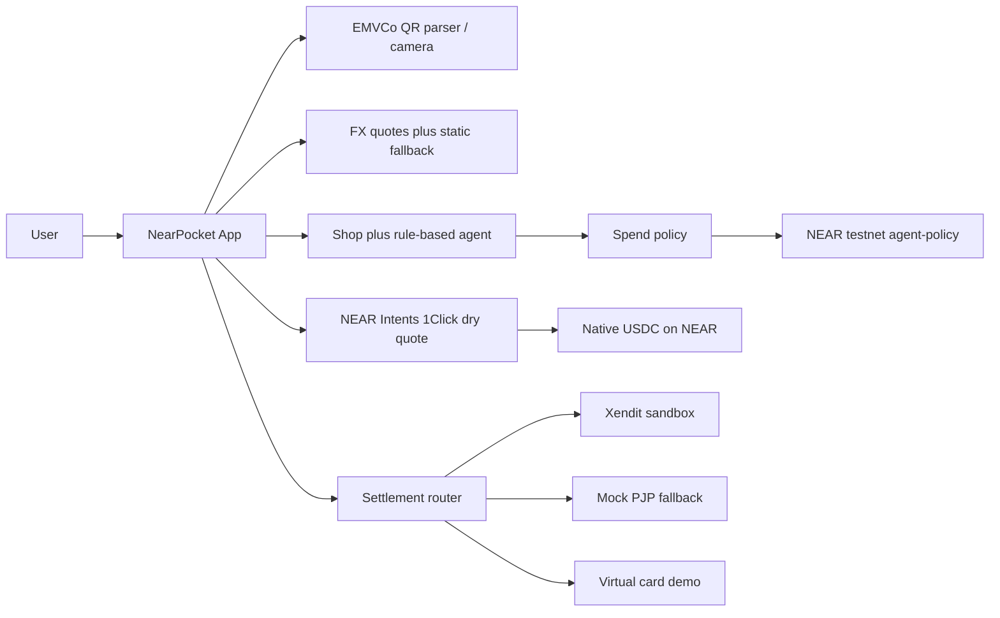

# NearPocket

People in Asia already pay by scanning a QR code, but a NEAR wallet still feels like a crypto app, and a shopping agent that can sign by itself can drain the balance. NearPocket is a NEAR testnet wallet that pays like a normal app: local QR in, USDC on NEAR underneath, and an agent that cannot spend until the user approves on-chain.

**Tracks:** [Real-World Money](https://nearhackathon.com) · [Agent Economy](https://nearhackathon.com) · deadline 14 Nov 2026 23:59 UTC  
**License:** MIT

## See it in 30 seconds

Live demo (no env, no install): **https://nearpocket.vercel.app**

Open the link, choose **Try demo**, scan the PromptPay sample on Pay, then ask the shop agent to watch a deal. Nothing in the demo moves real money.

<!-- GIF: drop a 30-second recording at docs/demo.gif. None is in the repo yet. -->

Screenshots: [landing](docs/screenshots/landing.png) · [home](docs/screenshots/home.png) · [pay](docs/screenshots/pay-confirm.png) · [shop](docs/screenshots/shop.png)

## Real vs demo

| Piece | Status |
| --- | --- |
| EMVCo parser + CRC + camera / upload | **Real** |
| FX (Frankfurter/ECB, cross-check open.er-api, static table if both are down) | **Real** when reachable; UI shows source. **Fallback rates** if not |
| Agent-policy contract on testnet | **Real** — [`nearly-7b1462.testnet`](https://testnet.nearblocks.io/address/nearly-7b1462.testnet) |
| NEAR Intents 1Click dry quote | **Real** public quote. Execution code is wired and **was not run** (see below) |
| Marketplace search | Amazon via DummyJSON when reachable; other shops **mocked**, with real search URLs, labeled |
| Xendit QRIS | **Real Test Mode** only when `XENDIT_SECRET_KEY` is set. If Xendit or 0xramp is unreachable (network or HTTP 5xx), settlement **falls back to the labeled mock**. A 4xx stays a failed receipt |
| NearPocket Card / top-up | **Demo** virtual card. Intents quotes are real |
| Wallet login | Meteor / HOT / Intear / NEAR Mobile · in-browser seed · Privy Google · **Demo** |
| QRIS, PromptPay, DuitNow, card | Highlighted flows (parser real; fiat settlement is sandbox / demo) |
| PayNow, JPQR, Korea QR | EMVCo parse is real. Settlement is demo |
| More rails (demo): QR Ph, VietQR, UPI (PH / VN / IN) | **Demo** corridors. Grouped that way on the landing page |

Crypto is not sent to merchants. That is a compliance choice (BI/OJK in Indonesia and the same idea elsewhere): production is user USDC on NEAR, then a licensed partner pays local fiat.

The contract account `nearly-7b1462.testnet` and the old Vercel alias `nearly-blue.vercel.app` still say **Nearly** because the project was renamed to NearPocket during the hackathon; a deployed NEAR account id cannot be renamed.

## On-chain proof

Signed as `nearly-7b1462.testnet` (the contract owner) against `nearly-7b1462.testnet`. Policy at the time of the run: daily limit 75 USDC, per-item max 30 USDC, approval required.

| Step | Result |
| --- | --- |
| queue_item within limit (1 USDC) | https://testnet.nearblocks.io/txns/CRQ7jCiqC7kfwFgZKjypHnpEAZrJRKAbo6Md9j76uVZo |
| queue_item over-limit item | https://testnet.nearblocks.io/txns/JoEUNyzqoQPhHC8wt8F3mNma4Bhqx6sES68cc8GGD7X |
| request_spend within limit | `awaiting_approval` — https://testnet.nearblocks.io/txns/55PR1ZeQ9v4Sm8Lt4tPUXQuAfS7KzxQABc9uGyqSotKm |
| approve_spend | https://testnet.nearblocks.io/txns/AyrVyKmo6HYhqCXCidM8XrrVjd5qGoSyb5NeYeTGdskB |
| request_spend over per-item limit (30.000001 USDC) | Rejected. Contract panicked at `src/lib.rs:160`: `over per-item max`. The script did not receive a transaction hash for this call. |

Earlier testnet transactions from the original deploy (6 Nov 2026), already on-chain:

| Action | Explorer |
| --- | --- |
| Deploy | https://testnet.nearblocks.io/txns/9uz6FqFYDertGpXWQ151ERaxsRzdPQhZkGLZiCAqy3sh |
| set_policy | https://testnet.nearblocks.io/txns/FB7CwPsFg77txpbvdGhC8AqwbeFH3JCmtuuVHUw9Hrf2 |
| queue_item | https://testnet.nearblocks.io/txns/AYg9utitCS6eMatv4QhHqyCGoVYp6QBy5VXnrWAMAPEU |
| request_spend | https://testnet.nearblocks.io/txns/3eFcr6dxLcnLkcYBKJXbAssTQA5ZCnkirQn4GD31q1cw |
| approve_spend | https://testnet.nearblocks.io/txns/Em45x6JBvu58xeVWxQm66hx2r6S4JYYxWbjeYtWoNpvD |
| upsert_plan | https://testnet.nearblocks.io/txns/7nYrj1ECqyxWQXRJTL6a7iXcfdVq6mT81FbFYYN7wuSg |

## Built during the hackathon

Every commit in this repository is dated **6–7 Nov 2026**. The first is `c4a4051` (2026-11-06 14:02 +0700, “Nearly — NEAR wallet…”). The hackathon window used here is the 1 Nov 2026 announcement through 14 Nov 2026 23:59 UTC. Nothing in `git log` predates 1 Nov. The agent-policy contract landed the same day in `972b9d9`, before the rebrand commit `9f9c61c`. There is no vendored pre-hackathon contract; the wasm in `contracts/agent-policy/res/` was built from `contracts/agent-policy/src/lib.rs`.

## What makes the agent an agent

The shop agent is **rule-based**, not an LLM. `src/lib/agent/rules.ts` parses a budget out of the user’s text, watches a price, and moves an item to `awaiting_approval` when the price hits the target. It never signs `approve_spend`.

If `NEAR_AI_API_KEY` or `OPENAI_API_KEY` is set on the server, `src/app/api/agent/route.ts` asks that model for **one sentence of copy**. The model cannot change the decision and cannot spend. With no key, the rule-based reason is what the user sees. NEAR AI Cloud is optional and unused in the public demo.

What stops a drain is the contract plus the key, not the prompt. See the threat model.

## Roadmap

The hackathon build stays on **NEAR testnet** so judges can click through it with no real funds and no custody of user money.

Production, after the hackathon:

1. Keep USDC on NEAR as the user’s balance. Still do not pay merchants in crypto.
2. Settle through a **licensed** payment partner (Xendit-class PJP for QRIS and the live cross-border corridors; a card issuer for the worldwide card). PH / VN / IN stay demo until a licensed partner covers them.
3. Indonesia: follow **BI/OJK** — crypto is not a payment instrument, so the partner converts to IDR and pays QRIS. Same pattern for other local regulators.
4. Business model: the quote already adds a **35 bps** fee (`FEE_BPS` in `src/lib/fx/quote.ts`), plus a revenue share with the licensed partner. Not switched on. No mainnet deployment in this repo.

## Threat model (agent-policy)

The contract records limits and a waitlist. It does **not** hold USDC. Moving tokens is a separate transaction the owner signs.

- `set_policy`, `approve_spend`, `queue_item`, and `upsert_plan` require `predecessor == owner`. A stranger’s call panics with `owner only`.
- The agent key should be a **function-call access key** whose method list is `request_spend` (views need no key). That key cannot approve, raise limits, or pause.
- With `require_approval` (the default, and the value on the deployed contract), `request_spend` only marks `awaiting_approval`. `spent_today` increases in `approve_spend`.
- `request_spend` and `approve_spend` both reject `over per-item max` and `over daily limit`. `paused` rejects both.
- The daily counter resets when `block_timestamp` crosses UTC midnight (`unix_day` in the contract). The reset is applied on the next call.
- Turning `require_approval` off lets `request_spend` count the spend immediately. Leave it on.
- Testnet only.

## FAQ

**Why not send crypto directly to the merchant?**  
In Indonesia, crypto is not a payment instrument under BI/OJK. NearPocket never transfers tokens to a merchant account. The intended production path is USDC on NEAR, then a licensed partner pays the merchant in local fiat (QRIS, PromptPay, DuitNow, or a card credit). The mock receipt and the Xendit adapter both say that; Xendit Test Mode creates a QR object, it does not send crypto.

**Who stops the agent draining the funds?**  
The agent-policy contract and the key. The agent can `request_spend` only up to the per-item and daily limits, and with approval required that call does not count as spent. `approve_spend` and `set_policy` are owner-only, so a function-call key that omits those methods cannot approve itself. The rule engine cannot sign either.

**What is real and what is mock?**  
The table at the top. Short version: EMVCo parse, FX (with a static fallback), the testnet policy contract, and 1Click **dry** quotes are real. Card, marketplace connect, PH/VN/IN rails, and fiat payout without a sandbox key are demo or mock and labeled as such.

**What is the mainnet plan, and how does this make money?**  
No mainnet in this submission. Later: licensed payout partners, the 35 bps fee already coded on FX quotes, and a partner revenue share. See Roadmap.

**What if the FX API or Xendit is down?**  
FX tries Frankfurter, then open.er-api, then the static `FALLBACK_USD` table in `src/lib/fx/quote.ts` (`source: "fallback"`). The pay screen still gets a number. If Xendit or 0xramp throws a network error or returns HTTP 5xx, `settle()` catches `PartnerDownError` and completes through the mock adapter with a timeline line that names the fallback. A bad key (HTTP 4xx) stays a failed receipt so a misconfigured secret is visible.

## NEAR Intents execution

Dry quotes are what the app calls today: `GET /api/quote?from=NEAR&amount=1` posts to 1Click with `dry: true` and `depositType: INTENTS`. If 1Click is unreachable, the response is a labeled local estimate (`real: false`).

The live path is in `src/lib/near/intents.ts`: `dry: false` → deposit address → `ft_transfer` plan (1 yoctoNEAR attached) → `GET /v0/status`. `POST /api/quote` with `{ "execute": true }` runs that only when `NEAR_INTENTS_EXECUTE=1`, and it still does **not** broadcast. `broadcastIntentDeposit` returns before any RPC unless `NEAR_INTENTS_EXECUTE`, `NEAR_INTENTS_BROADCAST`, and `NEAR_INTENTS_MAINNET_ACK` are all `1`. None of those are set in `.env.example` or in CI.

This was **verified with dry quotes and a mocked HTTP unit test** (`npm run test:intents`). It was **not** executed against live 1Click. A non-dry quote opens a mainnet deposit address, and broadcasting the deposit spends real funds. This hackathon build is testnet-only.

## How to run

No env vars required:

```bash
npm install
npm run dev
```

Open http://localhost:3000. `npm test` and `npm run build` also pass with an empty environment. Google login stays off until `NEXT_PUBLIC_PRIVY_APP_ID` is set. `XENDIT_SECRET_KEY` is server-only; it is not a `NEXT_PUBLIC_` variable.

```bash
npm test                 # EMVCo/QRIS, 378 i18n keys × 7 locales, Intents gate
npm run test:contract    # agent-policy unit tests (Rust 1.85+)
npm run lint
npm run build
```

Contract tests use the near-sdk mock VM, not a sandbox node, and they run in GitHub Actions (`.github/workflows/ci.yml`). Details: `contracts/agent-policy/README.md`.

### Testnet demo script

```bash
NEAR_ACCOUNT_ID=<owner.testnet> NEAR_PRIVATE_KEY='ed25519:...' npm run testnet:demo
# or
NEAR_CREDENTIALS_FILE=./.nearly-credentials/owner.json npm run testnet:demo
```

The JSON file is `{ "account_id", "private_key" }`. Default contract is `nearly-7b1462.testnet`. Override with `NEAR_CONTRACT_ID` or `--contract id.testnet`. Testnet only. Put the printed links in **On-chain proof** above.

### Optional env

See `.env.example`. `NEXT_PUBLIC_PRIVY_APP_ID` is a publishable id. Secrets (`XENDIT_SECRET_KEY`, `NEAR_PRIVATE_KEY`, AI keys, 0xramp) stay server-side or in the shell for the demo script.

### Judge walkthrough (~2 min)

1. `/` → **Sign in** → **Try demo**.
2. `/home` → USDC plus a local estimate. Settings → Thailand or Worldwide USD.
3. `/pay` → **PromptPay** sample → confirm → **Pay**.
4. `/shop` → search “earbuds” → **Ask agent** or **Buy now**. The agent waits.
5. `/activity` for the timeline.
6. `/api/contract` · `/api/quote?from=NEAR&amount=1` · `/api/fx?table=1`.

## Product map

| Route | What you do |
| --- | --- |
| `/` | Landing. QRIS, PromptPay, DuitNow, and the card are highlighted. PH / VN and the other demo rails sit under “More rails (demo)” |
| `/login` | Create wallet · Connect NEAR · Google/Privy · Try demo |
| `/home` | USDC balance · Scan & Pay · Top up · Shop · agent approvals |
| `/pay` | Camera / upload / paste / sample QR → confirm → settle |
| `/shop` | Marketplaces · Buy now / Ask agent · limits |
| `/activity` | Payments, purchases, card, top-ups, agent actions |
| `/settings` | Language · home country / display currency · FX table · Sign out |

`/belanja` → `/shop`, `/aktivitas` → `/activity`, `/app` → `/home`.

## Architecture



## License

MIT · Built at NEAR Hackathon, 6–7 Nov 2026.
